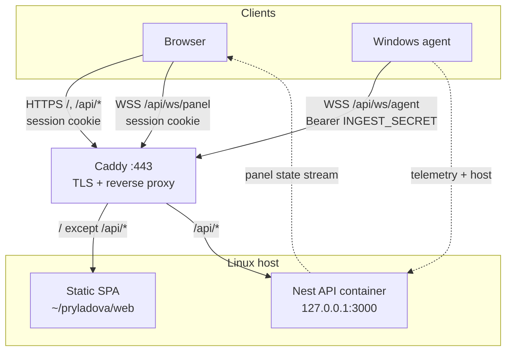

# Pryladova

Real-time desktop telemetry: a Windows agent streams active-window and host metrics to a NestJS API; a React web panel shows live state, activity history, and optional integration tiles (GitHub, Steam, Google Calendar/Tasks, weather).

Future work: [ROADMAP.md](ROADMAP.md).

## Prerequisites

- Node.js 26+ (see `package.json` `engines` and `.node-version`)
- pnpm
- Windows (agent)

## Install

Default (API + web + shared; skips Windows-native agent deps):

```powershell
pnpm install --filter "!agent"
```

Full install including the agent (Windows):

```powershell
pnpm install
```

Add a dependency with `pnpm --filter <workspace-name> add <pkg>`. The workspace that imports it declares that dependency in its own `package.json`.

## Run (local dev)

**All apps** (one terminal):

```powershell
pnpm dev
```

Or three terminals:

**1. API** — `http://localhost:3000`

```powershell
pnpm dev:api
```

Copy `apps/api/.env.example` to `apps/api/.env`. Variable names and local dev fixtures live only in that file. `INGEST_SECRET` must match the agent.

Supabase holds activity history, classification cache, and hub settings (including encrypted Google OAuth tokens). After pulling schema changes, run `pnpm db:push`. Google Calendar/Tasks: set OAuth vars per `apps/api/.env.example`, push migrations, then connect from the panel tiles.

When `GEMINI_API_KEY` is missing or the LLM call fails, telemetry is still stored with `classificationStatus: "failed"`.

Classification runs asynchronously after ingest — agent updates are never blocked on it; the web panel may show a pending spinner verb until the result arrives.

**2. Agent** — active window + host metrics over WebSocket (`/api/ws/agent`)

```powershell
pnpm dev:agent         # local API (DEV_API_URL)
pnpm dev:agent:remote  # VPS API (API_URL)
```

The agent's native modules are not top-level imports of files that cross-platform tests load. Use a dynamic import, or split the pure logic out.

Unsent polls are stored in `%LOCALAPPDATA%\pryladova\retry-queue.sqlite` and replayed in sequence order after reconnect.

Copy `apps/agent/.env.example` to `apps/agent/.env` (not committed; see `.gitignore`). Variable names, defaults, and remote-profile notes are in that file.

**Host metrics** (local Win32 / SMTC, every poll): idle time, CPU%, RAM%, uptime, now playing. SMTC album art is sent when the active player exposes a thumbnail (no extra config).

**Agent privacy** (local, before send):

- Blocked apps (password managers, SSH/RDP, crypto wallets, etc.) send `Secure` / `Redacted` instead of raw titles.
- Window titles keep tab names; emails and file paths are redacted to `[email]` and `[path]`.

**3. Web** — `http://localhost:5173` (proxies `/api` to the API)

```powershell
pnpm dev:web
```

Copy `apps/web/.env.example` to `apps/web/.env` when you want local Sentry.

Open the web URL and sign in (dev password in `apps/api/.env.example`). Telemetry appears after the agent connects. The panel streams state over WebSocket; login uses the session cookie on `/api/auth/*`. Integration tiles show when the API has the matching config. Click the weather chip to use browser location or search a city; choice is saved in the browser.

Dashboard tiles pack from the top with no gaps. Drag a header onto another tile to swap their place in that order; the grid repacks. Drag onto empty space in a row to move the tile there. Resizing a tile keeps it in that cell. Shrinking one pulls the tiles under it up so a fully empty row does not stay. On desktop, drag the side edges to resize width; drag the bottom edge to resize height; drag the horizontal band between rows to resize a whole row together. Use the reset control next to the theme toggle to restore the default layout. Mobile: full width, height resize only. Layout is persisted in browser `localStorage` (`pryladova.dashboardLayout`).

## Scripts

| Command                       | Description                                                   |
| ----------------------------- | ------------------------------------------------------------- |
| `pnpm dev`                    | API + agent + web in parallel                                 |
| `pnpm dev:api`                | NestJS API with watch                                         |
| `pnpm dev:agent`              | Telemetry agent (local API)                                   |
| `pnpm dev:agent:remote`       | Telemetry agent (remote VPS API)                              |
| `pnpm dev:web`                | Vite dev server                                               |
| `pnpm db:push`                | Apply Supabase migrations (linked project)                    |
| `pnpm check`                  | Typecheck + lint + build (turbo)                              |
| `pnpm verify`                 | Full CI locally (same gates as GitHub Actions)                |
| `pnpm build`                  | Build all packages (turbo)                                    |
| `pnpm typecheck`              | Typecheck all packages (turbo)                                |
| `pnpm lint` / `pnpm lint:fix` | Biome check / fix                                             |
| `pnpm knip`                   | Unused exports and dependencies                               |
| `pnpm test`                   | Vitest (shared, api, web, agent)                              |
| `pnpm test:coverage`          | Vitest with coverage report                                   |
| `pnpm test:e2e`               | Playwright on ports 3001 / 5174 (dev can stay on 3000 / 5173) |

## Testing

Automated coverage focuses on privacy, typed contracts, ingest auth, async classification, and the API → web stream path. Windows agent capture stays manual.

Before commit: `pnpm verify` (build, tests, coverage, e2e, knip, agent checks).

| Command              | What                                                                                                 |
| -------------------- | ---------------------------------------------------------------------------------------------------- |
| `pnpm verify`        | Full local CI — run before commit                                                                    |
| `pnpm test`          | Vitest unit + integration                                                                            |
| `pnpm test:coverage` | Same, with lcov output                                                                               |
| `pnpm test:e2e`      | Playwright: login, agent WebSocket → panel, dashboard layout, loading skeletons (API 3001, web 5174) |

First-time E2E: `pnpm exec playwright install chromium`

## Production

Same three apps as local dev; production serves the built SPA from disk and routes `/api/*` through Caddy instead of the Vite dev proxy.

Single Linux host (currently Oracle VPS + DuckDNS). **Step-by-step runbook:** [`deploy/README.md`](deploy/README.md) (prod panel auth: [`deploy/env.example`](deploy/env.example)).



Dashed arrows = logical data flow over the connections above (not a separate network path).

| Piece                    | Where                                                                                           | Auto on push to `main`? |
| ------------------------ | ----------------------------------------------------------------------------------------------- | ----------------------- |
| API container            | `~/pryladova/` + [`docker-compose.yml`](docker-compose.yml)                                     | Yes                     |
| Web static files         | `~/pryladova/web/`                                                                              | Yes                     |
| API secrets + panel auth | `~/pryladova/.env` ← [`deploy/env.example`](deploy/env.example)                                 | No — edit on host       |
| Caddy / TLS              | `/etc/caddy/Caddyfile` (+ domain/root via [`deploy/host.env.example`](deploy/host.env.example)) | No — edit on host       |
| Agent                    | `apps/agent/.env` on Windows                                                                    | No — edit on PC         |

Push to `main` → [CI](.github/workflows/ci.yml) must pass, including the agent job on `windows-latest` → [Deploy](.github/workflows/deploy.yml) builds the API image, uploads web + compose, restarts API.

Local `apps/api/.env` is for `pnpm dev` only.

## Layout

```
apps/agent   # Windows telemetry client
apps/api     # NestJS API (ESM, Supabase-backed persistence)
apps/web     # React + Vite + Tailwind v4
packages/shared   # Shared types and Zod schemas
deploy/           # runbook, bootstrap, Caddyfile, env examples
e2e/              # Playwright specs and runner
supabase/         # SQL migrations
```

`packages/*` do not import `apps/*`, and apps do not import each other. Shared code lives in `packages/shared`.
